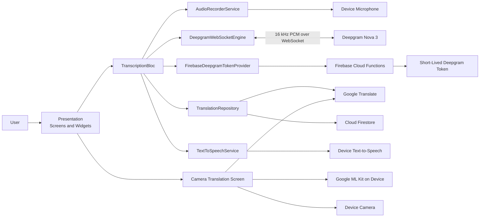
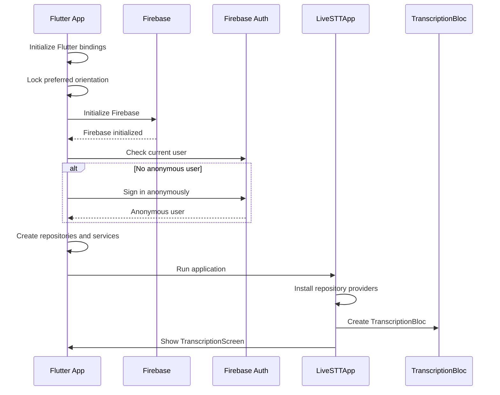
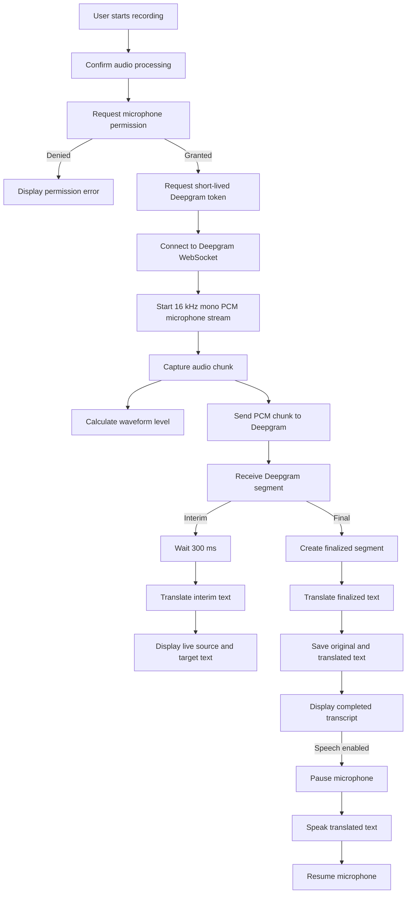
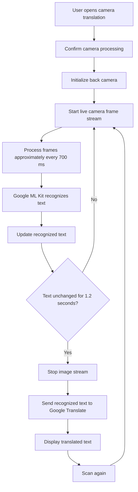
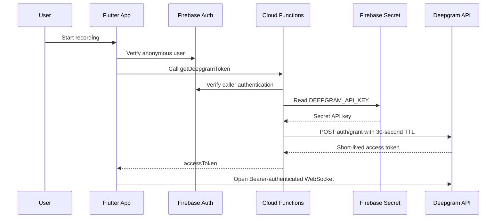
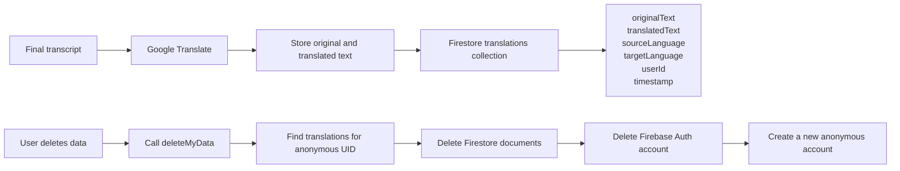
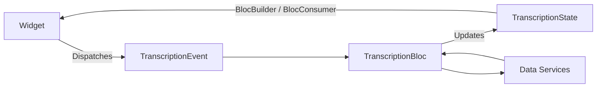
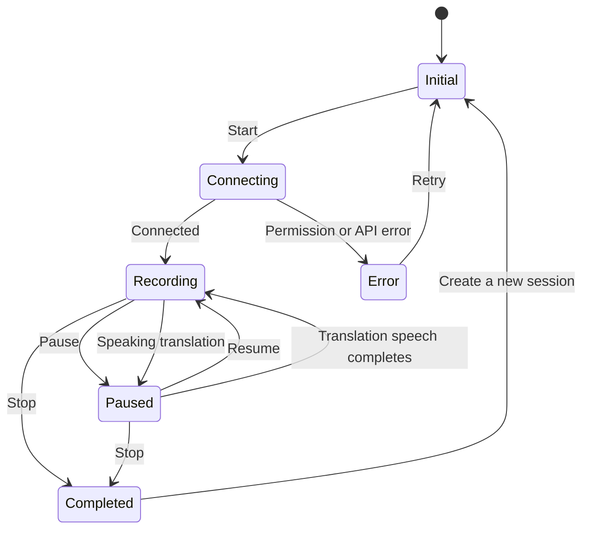

# Project Flow and Architecture

## Overview

This Flutter application combines live speech transcription, translation, spoken output, and camera-based text translation.

The main capabilities are:

- Live microphone transcription
- Simultaneous interim and final translation
- Spoken translated output
- On-device camera text recognition
- Firebase anonymous authentication
- Firestore translation history
- Deletion of user history and the anonymous account
- Privacy confirmation before microphone or camera use

The application entry point is `lib/main.dart`. The active UI and state management use the newer `TranscriptionBloc` and `TranscriptionScreen` implementation.

## High-Level Architecture



## Project Structure

```text
lib/
|-- main.dart
|-- Domain/
|   `-- Models/
|       |-- language_config.dart
|       `-- transcript_segment.dart
|-- Data/
|   |-- audio_recorder_service.dart
|   |-- deepgram_token_provider.dart
|   |-- text_to_speech.dart
|   |-- translation_api.dart
|   `-- websocket_transcription_engine.dart
`-- Presentation/
    |-- UI/
    |   |-- transcription_screen.dart
    |   `-- audio_visualizer.dart
    |-- bloc/
    |   |-- transcription_bloc.dart
    |   |-- transcription_event.dart
    |   `-- transcription_state.dart
    |-- camera_translation_screen.dart
    `-- pulsing_mic_animation.dart
```

### Presentation layer

The Presentation layer contains widgets and user interaction logic.

The main [transcription screen](../lib/Presentation/UI/transcription_screen.dart):

- Starts and stops recording
- Pauses and resumes transcription
- Displays interim and finalized transcripts
- Displays translations
- Changes source and target languages
- Enables or disables translated speech
- Opens camera translation
- Deletes user data
- Shows privacy and deletion confirmation dialogs

### Domain layer

The Domain layer contains application models and language definitions.

- `TranscriptionSegment` represents an interim or finalized transcript.
- `LanguageConfig` stores supported source and target languages.

### Data layer

The Data layer contains external integrations and service implementations.

- `AudioRecorderService` captures microphone audio.
- `DeepgramWebSocketEngine` sends audio to Deepgram and receives transcript segments.
- `FirebaseDeepgramTokenProvider` obtains temporary Deepgram credentials.
- `TranslationRepository` translates text and stores successful history.
- `TextToSpeechService` plays translated text.

## Startup Flow



Dependencies are created in `main()` and injected using `RepositoryProvider` and `BlocProvider`.

The app follows the system theme and provides a Material 3 light and dark theme.

## Live Speech Translation Flow



### Recording details

The recorder uses:

- 16 kHz sample rate
- 16-bit PCM
- Mono audio

The [audio recorder](../lib/Data/audio_recorder_service.dart) exposes a stream of raw audio chunks through the `AudioStreamRepository` abstraction.

The [Deepgram WebSocket engine](../lib/Data/websocket_transcription_engine.dart):

- Uses Nova 3
- Enables punctuation
- Enables interim results
- Enables smart formatting
- Supports automatic or selected source language
- Sends binary audio chunks
- Sends a close-stream message before disconnecting

### Interim and final processing

Interim transcription text is translated after a 300 ms debounce period. Generation counters prevent stale interim or target-language translation results from updating the UI after the language changes.

Each finalized segment is translated and saved to Firestore. Duplicate segment IDs are tracked so the same final result is not processed twice.

Translation errors are displayed without stopping transcription.

### Microphone feedback prevention

Before speaking a translated result, the BLoC pauses microphone capture. It then:

1. Plays the translated text with `flutter_tts`.
2. Returns from the speech operation.
3. Resumes the microphone when the session was recording.

This prevents the app from transcribing its own spoken translation.

## Camera Translation Flow



The camera screen supports script-aware recognition:

- Latin
- Chinese
- Devanagari
- Japanese

The user may choose a source language to select the recognition script. If text remains unchanged for approximately 1.2 seconds, recognition stops automatically. The user can also translate immediately or scan again.

Camera images are not uploaded or saved. Recognized text is sent to Google Translate for translation.

## Firebase Credential Flow



The Deepgram key remains in Firebase Secrets. It is not stored in the Flutter source or supplied through a Dart define.

## Translation History and Deletion Flow



The deletion action is only available when transcription is not active.

## State Management

### BLoC pattern

The active architecture uses `flutter_bloc`.



Events include:

- `StartTranscriptionRequested`
- `PauseTranscriptionRequested`
- `ResumeTranscriptionRequested`
- `StopTranscriptionRequested`
- `AudioChunkCaptured`
- `SegmentReceived`
- `TranslateInterimTextRequested`
- `LanguageChanged`
- `TargetLanguageChanged`
- `TargetAudioOnlyChanged`

The state contains:

- Current transcription status
- Interim segment
- Interim translation
- Finalized segments
- Translations
- Source and target languages
- Speech playback setting
- Audio visualization levels
- Error message

The state implements `Equatable` so widgets receive predictable state comparisons.

### Transcription status



## Architectural Pattern

The project uses a lightweight layered architecture combined with the BLoC pattern:

```text
Presentation
    Screens, widgets, BLoC events and states
          |
          v
Data
    Services, repositories and external integrations
          |
          v
Domain
    Models and shared configuration
```

The architecture uses these patterns:

| Pattern | Usage |
|---|---|
| BLoC | Separates UI events, application logic and immutable state |
| Repository | Abstracts translation and storage operations |
| Service abstraction | Encapsulates audio, TTS and transcription integrations |
| Dependency injection | Uses Flutter providers and constructor injection |
| Stream processing | Connects microphone chunks and WebSocket segments |
| State machine | Controls recording, pausing and connection states |
| Debouncing | Limits interim translation requests |
| Generation counters | Rejects stale async translation results |
| Stable text detection | Stops camera recognition after text stabilizes |
| Privacy confirmation | Requires consent before microphone and camera processing |

## Technologies Used

| Area | Technology |
|---|---|
| Framework | Flutter |
| Language | Dart |
| State management | `flutter_bloc` |
| State comparison | `equatable` |
| Live speech recognition | Deepgram Nova 3 |
| Audio transport | WebSocket |
| Microphone capture | `record` package |
| Translation | `translator` package using Google Translate |
| Text-to-speech | `flutter_tts` |
| Camera | `camera` package |
| On-device OCR | Google ML Kit Text Recognition |
| Authentication | Firebase Anonymous Authentication |
| Database | Cloud Firestore |
| Backend API | Firebase Cloud Functions |
| Theme | Material 3 |
| Platform permissions | Android and iOS app permissions |

## Privacy Characteristics

The app does the following:

- Streams microphone audio to Deepgram for transcription.
- Sends transcript text to Google Translate.
- Saves finalized transcript and translation text in Firestore.
- Uses an anonymous Firebase account.
- Keeps the Deepgram API key in Firebase Secrets.
- Performs camera text recognition on the device.
- Sends only recognized text to Google Translate.
- Does not upload or save camera images.
- Does not explicitly save raw audio recordings.
- Allows the user to delete saved history and the anonymous account.

## Unique Feature Combination

The app's distinctive combination is live speech transcription plus live translation plus translated speech playback and on-device camera OCR.

Important implementation details include:

- Interim speech is translated every 300 ms.
- Microphone capture pauses during translated speech playback.
- Finalized text is saved and can be retranslated after a language change.
- Camera recognition pauses after recognized text stabilizes.
- Recognition scripts can be selected for Latin, Chinese, Devanagari or Japanese text.
- The Deepgram API key is never placed in the Flutter app.
- Firestore history and the anonymous account can be deleted completely.

## Legacy and Alternate Code

The repository contains older or alternate implementations that are not used by the active `main()` entry point:

- `lib/Bloc/translation_bloc.dart`
- `lib/Presentation/translation_screen.dart`
- `lib/Presentation/camera_text_recognition_screen.dart`
- The older `MyApp` implementation in `main.dart`

The active application uses:

- `LiveSTTApp`
- `TranscriptionBloc`
- `TranscriptionScreen`
- `CameraTranslationScreen`

